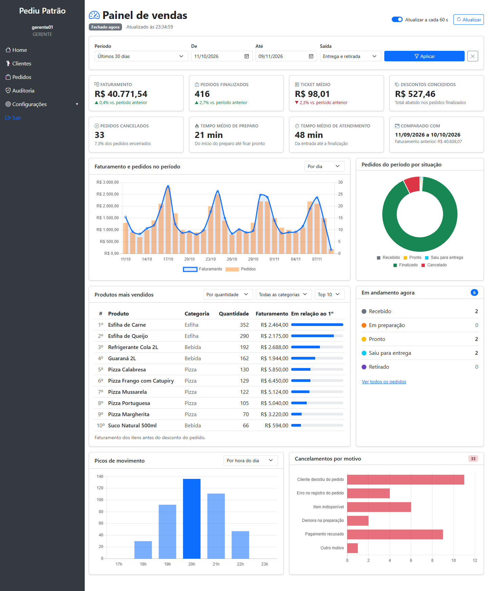
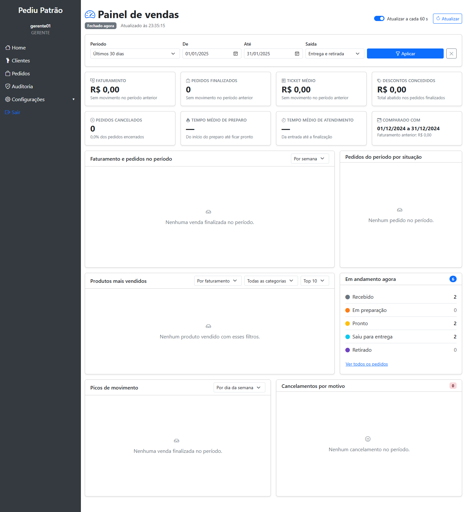
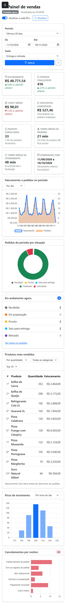

# PediuPatrão

Sistema de gestão de uma pizzaria (clientes, produtos, pedidos, entregas e auditoria) desenvolvido em atividades práticas individuais de Engenharia de Software.

| Atividade | Conteúdo | Onde ler |
|---|---|---|
| **Dashboard Administrativo** | Painel de vendas do gerente alimentado por uma API própria (RF01 a RF07) | [Dashboard Administrativo](#dashboard-administrativo) |
| **Atividade M1** | Perfis de acesso, fluxo de pedidos, desconto, cancelamento e auditoria | [Atividade M1](#atividade-m1) |

**Tecnologias:** Java 21, Spring Boot 3.4.4, Spring Security 6, Thymeleaf, MongoDB e Chart.js 2.9.4.

---

## Como executar

Pré-requisitos (tudo roda localmente, sem Docker):

- JDK 21
- MongoDB Community em `localhost:27017` (serviço do Windows, sem autenticação)

### Modo normal

```powershell
.\mvnw.cmd spring-boot:run
```

Usa o banco `pizzaria`. Acesse <http://localhost:8080>. O Maven Wrapper baixa o Maven na primeira execução.

### Modo de demonstração do painel

```powershell
.\mvnw.cmd spring-boot:run "-Dspring-boot.run.profiles=demo"
```

Usa um banco **separado**, `pizzaria_demo`, e na primeira execução gera um movimento fictício de 90 dias: 13 produtos em 5 categorias, 20 clientes, 3 entregadores e cerca de 1.250 pedidos com histórico completo de status. O banco `pizzaria` nunca é alterado por esse modo. Para recomeçar do zero, basta apagar o banco `pizzaria_demo`.

### Testes

```powershell
.\mvnw.cmd test
```

Os testes usam o banco `pizzaria_test`, limpo pelos próprios testes.

### Usuários

Criados automaticamente na primeira execução, em qualquer modo (`SemeadorDeContas`). Servem apenas para uso local.

| Usuário | Senha | Perfil | Página inicial |
|---|---|---|---|
| `admin` | `luffy` | ADMIN | Boas-vindas |
| `gerente01` | `zoro` | GERENTE | **Painel de vendas** |
| `atendente01` | `chopper` | ATENDENTE | Boas-vindas |

---

## Dashboard Administrativo

Painel que permite ao responsável pelo estabelecimento acompanhar o desempenho das vendas, a situação dos pedidos e as tendências da operação. Ele fica na página inicial do **GERENTE** e busca todos os seus dados numa API própria, `/api/painel`, que calcula os números diretamente no MongoDB.



### Requisitos funcionais

| Requisito | O que o painel entrega | Critério de aceite |
|---|---|---|
| **RF01 — Indicadores gerais de vendas** | Faturamento, pedidos finalizados, ticket médio, descontos concedidos, pedidos cancelados com taxa de cancelamento, tempo médio de preparo e tempo médio de atendimento, cada um comparado com o período anterior de mesmo tamanho | Os valores consideram só pedidos `FINALIZADO` do período; a variação aparece em % e fica vazia quando o período anterior não teve movimento |
| **RF02 — Análise de vendas (gráficos)** | Linha do tempo de faturamento e pedidos (por dia, semana ou mês) e picos de movimento (por hora do dia, dia da semana ou tipo de saída) | Intervalos sem venda aparecem com zero, sem buracos no gráfico; o agrupamento por dia e hora respeita o horário de Brasília |
| **RF03 — Situação dos pedidos** | Pedidos do período por status (gráfico de rosca), pedidos em andamento agora e cancelamentos por motivo | Todos os status e motivos aparecem, inclusive os com zero; "em andamento agora" não depende do período |
| **RF04 — Produtos mais vendidos** | Ranking por quantidade ou por faturamento, com filtro de categoria e tamanho (Top 5, 10 ou 20) | Considera só pedidos finalizados; o nome exibido é o mais recente do produto; itens antigos sem categoria aparecem como "Sem categoria" |
| **RF05 — Filtros de consulta** | Período com atalhos (hoje, 7, 30 ou 90 dias, mês atual ou datas livres) e tipo de saída (entrega, retirada ou ambos), aplicados a todos os blocos; cada gráfico tem também o seu próprio agrupamento | Período inválido é recusado na tela e na API; o período máximo é de 366 dias |
| **RF06 — Integração com a API** | A tela não recebe números prontos do servidor: cada bloco chama o seu endpoint em `/api/painel` | Os 7 endpoints estão documentados abaixo e respondem JSON |
| **RF07 — Atualização e tratamento de dados** | Atualização automática a cada 60 segundos (pode ser desligada), botão "Atualizar" e horário da última atualização; cada bloco tem estados de carregando, vazio e erro com "Tentar novamente"; valores em R$ e datas no formato brasileiro | Um bloco com erro não derruba os outros; sessão expirada leva ao login; pedidos antigos sem histórico ou sem categoria não quebram os cálculos |

### Requisitos não funcionais

| Requisito | Como foi atendido |
|---|---|
| **Segurança** | Painel e API exclusivos do GERENTE, em duas camadas: regra por rota no `SecurityConfig` e `@PreAuthorize` no serviço. A API só aceita leitura (`GET`). Sem login, 401; com outro perfil, 403 |
| **Desempenho** | Somas, médias e agrupamentos são feitos pelo próprio MongoDB (pipelines de agregação), sem trazer os pedidos para a aplicação. Índices em `dataHoraEntrada` e em `status + dataHoraEntrada`. Período limitado a 366 dias |
| **Confiabilidade dos dados** | Valores em `BigDecimal` (Decimal128 no banco) com 2 casas e arredondamento `HALF_UP`; agrupamento por dia e hora no mesmo fuso usado na gravação; dados antigos incompletos tratados sem erro |
| **Usabilidade** | Layout responsivo (computador e celular), mensagens em português, formatação brasileira de moeda, números e datas, e estados claros quando não há dados |
| **Manutenibilidade** | Camadas separadas (tela, controller, serviço, agregações), DTOs de resposta, enums no lugar de textos livres, nenhum comentário no código e testes automatizados em todas as camadas |
| **Compatibilidade** | Java 21, MongoDB local e Chart.js servido pelo próprio projeto; apenas o Bootstrap e os ícones dependem de CDN |

### Decisões de análise e projeto

| Tema | Decisão | Motivo |
|---|---|---|
| O que é venda | Somente pedido `FINALIZADO` | Cancelados e em andamento ainda não são receita |
| Data de referência | Data de **entrada** do pedido | O mesmo filtro significa a mesma coisa em todos os blocos (vendas, cancelados e situação) |
| Quem acessa | Somente o GERENTE | É o responsável pelo estabelecimento; o ADMIN é um perfil técnico de usuários |
| Onde fica | Página inicial do GERENTE | A home estava praticamente vazia; os demais perfis continuam com a tela de boas-vindas |
| Desenho da API | Um endpoint por bloco do painel | Cada bloco carrega e trata erro sozinho, e cada endpoint é documentado e testado isoladamente |
| Onde calcular | Agregações no MongoDB | Escala com o volume de pedidos, sem carregar todos na memória |
| Fuso horário | Agrupar no fuso usado para gravar as datas | Sem isso, um pedido feito às 23h30 cairia no dia seguinte |
| Histórico de status | Cada mudança de status grava status, data/hora e responsável no pedido | Permite calcular os tempos médios de preparo e de atendimento; o histórico também aparece no detalhe do pedido |
| Categoria no item | A categoria do produto é copiada para o item no momento da venda | O ranking por categoria não muda se o produto for editado depois |
| Ranking | Dois critérios (quantidade e faturamento) | Contam histórias diferentes: esfihas lideram em unidades, pizzas lideram em receita |
| Dados de demonstração | Banco separado e geração com semente fixa | Não mistura dados fictícios com reais, e o resultado é sempre o mesmo, o que permite testar |
| Gráficos | Chart.js 2.9.4, que já estava no projeto | Nenhuma dependência nova |

### Arquitetura do painel

```
Tela (home.html + painel.js)
   │  fetch GET /api/painel/...
   ▼
PainelController ──► PainelDeVendasService ──► AgregacoesDePedidos ──► MongoDB (coleção pedidos)
                      período, comparativo,      pipelines de agregação
                      preenchimento de lacunas   ($match, $group, $unwind...)
```

| Camada | Arquivos |
|---|---|
| Tela | `templates/home.html`, `static/js/painel.js`, `static/css/painel.css` |
| API | `controller/PainelController.java` |
| Regras | `service/PainelDeVendasService.java`, `service/CalculadoraDeIndicadores.java` |
| Consultas ao banco | `repository/AgregacoesDePedidos.java` |
| Contratos (entrada e saída) | `dto/painel/*` |
| Dados de demonstração | `config/demonstracao/*` (só no modo `demo`) |

### Documentação da API

Base: `/api/painel`. Todos os endpoints são `GET`, respondem JSON e exigem login com o perfil **GERENTE** (sessão do navegador).

#### Parâmetros comuns

Aceitos por todos os endpoints, exceto `/filtros`:

| Parâmetro | Tipo | Obrigatório | Descrição |
|---|---|---|---|
| `de` | data `AAAA-MM-DD` | não | Início do período (inclusivo). Sem ele, o período termina em `ate` e tem 30 dias |
| `ate` | data `AAAA-MM-DD` | não | Fim do período (inclusivo). Sem ele, termina hoje |
| `tipoSaida` | `ENTREGA` ou `RETIRADA` | não | Restringe a um tipo de saída. Sem ele, considera os dois |

Sem nenhum parâmetro, o período é o dos **últimos 30 dias**. O período considera a data de entrada do pedido e pode ter no máximo 366 dias.

#### Erros

Todos os erros com corpo seguem o formato `{"mensagem": "..."}`.

| Status | Quando acontece | Exemplo de resposta |
|---|---|---|
| 400 | Data inicial depois da final | `{"mensagem":"A data inicial (de) não pode ser posterior à data final (ate)"}` |
| 400 | Período maior que 366 dias | `{"mensagem":"O período consultado pode ter no máximo 366 dias"}` |
| 400 | Data em formato inválido (ex.: `de=2026-13-01`) | `{"mensagem":"Valor inválido para o parâmetro de"}` |
| 400 | Valor fora da lista (ex.: `granularidade=ANO`) | `{"mensagem":"Valor inválido para o parâmetro granularidade"}` |
| 400 | Limite do ranking fora de 1 a 50 | `{"mensagem":"O limite do ranking deve ficar entre 1 e 50"}` |
| 401 | Sem login | sem corpo |
| 403 | Logado com ADMIN ou ATENDENTE, ou método diferente de `GET` | `{"mensagem":"Você não tem permissão para executar esta operação"}` |

Os exemplos de resposta abaixo foram obtidos da API real no modo de demonstração, com o período de outubro de 2026.

#### `GET /api/painel/indicadores`

Indicadores gerais de vendas (RF01) e comparação com o período anterior de mesmo tamanho.

```http
GET /api/painel/indicadores?de=2026-10-01&ate=2026-10-31
```

```json
{
  "periodo": { "de": "2026-10-01", "ate": "2026-10-31" },
  "faturamento": 44667.91,
  "pedidosFinalizados": 447,
  "ticketMedio": 99.93,
  "descontosConcedidos": 473.59,
  "pedidosCancelados": 36,
  "taxaDeCancelamento": 7.5,
  "tempoMedioDePreparoEmMinutos": 21,
  "tempoMedioDeAtendimentoEmMinutos": 49,
  "comparativo": {
    "periodoAnterior": { "de": "2026-08-31", "ate": "2026-09-30" },
    "faturamentoAnterior": 37118.70,
    "variacaoDoFaturamento": 20.3,
    "pedidosAnteriores": 371,
    "variacaoDosPedidos": 20.5,
    "ticketMedioAnterior": 100.05,
    "variacaoDoTicketMedio": -0.1
  }
}
```

| Campo | Significado |
|---|---|
| `faturamento` | Soma do valor total (já com desconto) dos pedidos finalizados |
| `ticketMedio` | Faturamento ÷ pedidos finalizados |
| `taxaDeCancelamento` | Cancelados ÷ (finalizados + cancelados), em % |
| `tempoMedioDePreparoEmMinutos` | Média entre "em preparação" e "pronto"; `null` se não houver histórico de status |
| `tempoMedioDeAtendimentoEmMinutos` | Média entre a entrada e a finalização; `null` se não houver histórico |
| `variacao...` | Variação em % sobre o período anterior; `null` quando o período anterior não teve movimento |

#### `GET /api/painel/vendas/serie`

Linha do tempo de faturamento e pedidos finalizados (RF02).

| Parâmetro | Valores | Padrão |
|---|---|---|
| `granularidade` | `DIA`, `SEMANA` (começa na segunda-feira) ou `MES` | `DIA` |

```http
GET /api/painel/vendas/serie?de=2026-10-01&ate=2026-10-31&granularidade=SEMANA
```

```json
{
  "periodo": { "de": "2026-10-01", "ate": "2026-10-31" },
  "granularidade": "SEMANA",
  "pontos": [
    { "inicio": "2026-09-28", "rotulo": "28/09", "faturamento": 6168.65, "pedidos": 60 },
    { "inicio": "2026-10-05", "rotulo": "05/10", "faturamento": 10301.77, "pedidos": 100 },
    { "inicio": "2026-10-12", "rotulo": "12/10", "faturamento": 10088.00, "pedidos": 106 },
    { "inicio": "2026-10-19", "rotulo": "19/10", "faturamento": 9520.34, "pedidos": 97 },
    { "inicio": "2026-10-26", "rotulo": "26/10", "faturamento": 8589.15, "pedidos": 84 }
  ]
}
```

Cada ponto soma apenas os dias que estão dentro do período. Intervalos sem venda aparecem com zero.

#### `GET /api/painel/vendas/distribuicao`

Picos de movimento dos pedidos finalizados (RF02).

| Parâmetro | Valores | Padrão |
|---|---|---|
| `dimensao` | `HORA` (0 a 23), `DIA_DA_SEMANA` (1 = segunda a 7 = domingo) ou `TIPO_SAIDA` | `HORA` |

```http
GET /api/painel/vendas/distribuicao?de=2026-10-01&ate=2026-10-31&dimensao=DIA_DA_SEMANA
```

```json
{
  "periodo": { "de": "2026-10-01", "ate": "2026-10-31" },
  "dimensao": "DIA_DA_SEMANA",
  "fatias": [
    { "chave": "1", "rotulo": "Seg", "faturamento": 3713.67, "pedidos": 36 },
    { "chave": "2", "rotulo": "Ter", "faturamento": 3763.05, "pedidos": 36 },
    { "chave": "3", "rotulo": "Qua", "faturamento": 3799.50, "pedidos": 38 },
    { "chave": "4", "rotulo": "Qui", "faturamento": 5765.10, "pedidos": 59 },
    { "chave": "5", "rotulo": "Sex", "faturamento": 10054.75, "pedidos": 100 },
    { "chave": "6", "rotulo": "Sáb", "faturamento": 11934.12, "pedidos": 119 },
    { "chave": "7", "rotulo": "Dom", "faturamento": 5637.72, "pedidos": 59 }
  ]
}
```

#### `GET /api/painel/pedidos/situacao`

Pedidos por status (RF03). `noPeriodo` considera todos os pedidos que entraram no período; `emAndamentoAgora` mostra os pedidos ainda abertos, independentemente do período (respeita só o `tipoSaida`).

```http
GET /api/painel/pedidos/situacao?de=2026-10-01&ate=2026-10-31
```

```json
{
  "periodo": { "de": "2026-10-01", "ate": "2026-10-31" },
  "totalNoPeriodo": 483,
  "noPeriodo": [
    { "status": "RECEBIDO", "quantidade": 0 },
    { "status": "EM_PREPARACAO", "quantidade": 0 },
    { "status": "PRONTO", "quantidade": 0 },
    { "status": "SAIU_PARA_ENTREGA", "quantidade": 0 },
    { "status": "RETIRADO", "quantidade": 0 },
    { "status": "FINALIZADO", "quantidade": 447 },
    { "status": "CANCELADO", "quantidade": 36 }
  ],
  "totalEmAndamentoAgora": 6,
  "emAndamentoAgora": [
    { "status": "RECEBIDO", "quantidade": 2 },
    { "status": "EM_PREPARACAO", "quantidade": 0 },
    { "status": "PRONTO", "quantidade": 2 },
    { "status": "SAIU_PARA_ENTREGA", "quantidade": 2 },
    { "status": "RETIRADO", "quantidade": 0 }
  ]
}
```

#### `GET /api/painel/pedidos/cancelamentos`

Cancelamentos do período por motivo (RF03).

```http
GET /api/painel/pedidos/cancelamentos?de=2026-10-01&ate=2026-10-31
```

```json
{
  "periodo": { "de": "2026-10-01", "ate": "2026-10-31" },
  "total": 36,
  "motivos": [
    { "motivo": "CLIENTE_DESISTIU", "descricao": "Cliente desistiu do pedido", "quantidade": 11 },
    { "motivo": "ERRO_NO_PEDIDO", "descricao": "Erro no registro do pedido", "quantidade": 5 },
    { "motivo": "ITEM_INDISPONIVEL", "descricao": "Item indisponível", "quantidade": 7 },
    { "motivo": "DEMORA_NA_PREPARACAO", "descricao": "Demora na preparação", "quantidade": 3 },
    { "motivo": "PAGAMENTO_RECUSADO", "descricao": "Pagamento recusado", "quantidade": 7 },
    { "motivo": "OUTRO", "descricao": "Outro motivo", "quantidade": 3 }
  ]
}
```

#### `GET /api/painel/produtos/mais-vendidos`

Ranking dos produtos nos pedidos finalizados (RF04).

| Parâmetro | Valores | Padrão |
|---|---|---|
| `ordenarPor` | `QUANTIDADE` ou `FATURAMENTO` | `QUANTIDADE` |
| `categoria` | Nome exato de uma categoria (ver `/filtros`) | todas |
| `limite` | 1 a 50 | 10 |

```http
GET /api/painel/produtos/mais-vendidos?de=2026-10-01&ate=2026-10-31&ordenarPor=FATURAMENTO&limite=3
```

```json
{
  "periodo": { "de": "2026-10-01", "ate": "2026-10-31" },
  "criterio": "FATURAMENTO",
  "categoria": null,
  "produtos": [
    { "posicao": 1, "produtoId": "6af2800f143de60725018d06", "nome": "Pizza Calabresa", "categoria": "Pizza", "quantidade": 150, "faturamento": 6750.00 },
    { "posicao": 2, "produtoId": "6af2800f143de60725018d09", "nome": "Pizza Frango com Catupiry", "categoria": "Pizza", "quantidade": 127, "faturamento": 6350.00 },
    { "posicao": 3, "produtoId": "6af2800f143de60725018d07", "nome": "Pizza Mussarela", "categoria": "Pizza", "quantidade": 142, "faturamento": 5964.00 }
  ]
}
```

O `faturamento` de cada produto é a soma dos subtotais dos itens, antes do desconto aplicado ao pedido.

#### `GET /api/painel/filtros`

Opções para montar os filtros da tela (RF05). Não recebe parâmetros.

```http
GET /api/painel/filtros
```

```json
{
  "periodoPadrao": { "de": "2026-10-11", "ate": "2026-11-09" },
  "diasDoPeriodoMaximo": 366,
  "tiposSaida": ["ENTREGA", "RETIRADA"],
  "categorias": ["Bebida", "Esfiha", "Lanche", "Pizza", "Porção"],
  "granularidades": ["DIA", "SEMANA", "MES"],
  "dimensoes": ["HORA", "DIA_DA_SEMANA", "TIPO_SAIDA"],
  "criteriosDeRanking": ["QUANTIDADE", "FATURAMENTO"],
  "limiteMaximoDoRanking": 50
}
```

As categorias reúnem as do cardápio atual e as que aparecem em pedidos antigos.

### Evidências de testes

#### Testes automatizados

```
[INFO] Tests run: 414, Failures: 0, Errors: 0, Skipped: 0
[INFO] BUILD SUCCESS
```

A suíte passou de 303 testes (entrega da M1) para **414**. Os 111 testes novos desta atividade:

| Classe de teste | Tipo | Testes | O que comprova |
|---|---|:-:|---|
| `AgregacoesDePedidosTest` | Integração com MongoDB | 20 | Somas, filtros por período e tipo de saída, limites do período, agrupamento no fuso correto (pedido das 23h30), ranking, tempos médios, dados antigos |
| `PainelApiTest` | Integração HTTP | 22 | JSON de cada endpoint, valores calculados, mensagens de erro 400, 401 e 403 |
| `PainelDeVendasServiceTest` | Unitário | 16 | Período padrão, comparativo, preenchimento de lacunas por dia, semana e mês, limites do ranking |
| `GeradorDeMovimentoTest` | Unitário | 13 | Dados de demonstração coerentes: valores, histórico, horários, pedidos em andamento, sazonalidade |
| `PeriodoDoPainelTest` | Unitário | 8 | Período padrão, inversão, máximo de 366 dias, período anterior |
| `CalculadoraDeIndicadoresTest` | Unitário | 6 | Ticket médio, percentuais e variação com arredondamento |
| `PaginaInicialTelaTest` | Integração de tela | 5 | Painel só para o GERENTE, demais perfis com a tela de boas-vindas |
| `SemeadorDeDemonstracaoTest` | Integração com MongoDB | 4 | Carga da base de demonstração sem duplicar nem misturar com dados existentes |
| `PedidoTest` | Unitário | 4 | Histórico de status no pedido |
| `IndicesDoPedidoTest` | Integração com MongoDB | 1 | Índices usados nas consultas por período |
| Testes da M1 ampliados | Unitário e integração | 12 | Histórico gravado ao criar, avançar e cancelar; categoria copiada para o item; histórico no detalhe do pedido; regras de acesso do painel |

#### Teste de ponta a ponta com a aplicação real

Aplicação iniciada, login feito pelo formulário e API chamada com a sessão de cada perfil:

| Chamada | Perfil | Status | Resposta |
|---|---|:-:|---|
| `GET /api/painel/indicadores` | GERENTE | 200 | Indicadores calculados no banco |
| `GET /api/painel/indicadores?de=2026-10-31&ate=2026-10-01` | GERENTE | 400 | `A data inicial (de) não pode ser posterior à data final (ate)` |
| `GET /api/painel/vendas/serie?de=2026-13-01` | GERENTE | 400 | `Valor inválido para o parâmetro de` |
| `GET /api/painel/indicadores` | ATENDENTE | 403 | `Você não tem permissão para executar esta operação` |
| `GET /api/painel/indicadores` | sem login | 401 | — |

O painel também foi aberto num navegador (Edge) com o login do gerente: todos os blocos carregaram sem erros de JavaScript, os controles de cada gráfico atualizaram os dados, o período invertido exibiu o aviso na tela e um período sem vendas exibiu os estados vazios.

| Período sem vendas | Celular |
|---|---|
|  |  |

### Branches (gitflow)

| Referência | Conteúdo |
|---|---|
| `main` | Versão estável |
| tag `v1.0-m1` | Ponto exato da entrega da Atividade M1 |
| `feature/dashboard` | Implementação do painel, criada a partir da `main` e integrada por Pull Request |

Commits da `feature/dashboard`:

1. Registra histórico de status e categoria dos itens do pedido
2. Implementa a API do painel administrativo de vendas
3. Adiciona dados de demonstração para o painel
4. Implementa a tela do painel de vendas na página inicial do gerente
5. Documentação (este README)

### Vídeo de apresentação

Link: *(a incluir)*

---

## Atividade M1

Evolução do sistema com **controle de acesso por perfil**, **fluxo controlado de pedidos** e **auditoria persistente**.

### Perfis e permissões

| Capacidade | ADMIN | GERENTE | ATENDENTE |
|---|:-:|:-:|:-:|
| Criar, editar e remover usuários; atribuir perfis | ✅ | ❌ | ❌ |
| Consultar pedidos | ✅ | ✅ | ✅ |
| Registrar pedido e avançar o status | ❌ | ✅ | ✅ |
| Aplicar desconto | ❌ | ✅ | ❌ |
| Cancelar pedido | ❌ | ✅ | ❌ |
| Cadastrar e alterar clientes | ❌ | ❌ | ✅ |
| Consultar clientes | ❌ | ✅ | ✅ |
| Inativar cliente | ❌ | ✅ | ❌ |
| Consultar produtos | ✅ | ✅ | ✅ |
| Criar, editar e remover produtos | ❌ | ✅ | ❌ |
| Consultar funcionários, entregadores e horários | ✅ | ✅ | ✅ |
| Criar, editar e inativar funcionários e entregadores; alterar horários | ❌ | ✅ | ❌ |
| Consultar auditoria | ✅ | ✅ | ❌ |
| Painel de vendas | ❌ | ✅ | ❌ |

A autorização é feita **no backend**: regras por rota em `SecurityConfig` (qualquer rota não listada é negada) e `@PreAuthorize` nos serviços como segunda camada. Esconder botões nas telas é só conveniência e não substitui essas regras.

### Requisitos implementados

#### RF01 — Usuários e permissões
- Três perfis reais (`Perfil`), gravados no banco e convertidos em autoridades pelo `UsuarioDetailsService`. Usuário sem perfil válido não acessa nada.
- API de usuários restrita ao ADMIN; a resposta nunca inclui a senha (hash).
- Proteção contra autoelevação: ninguém altera o próprio perfil nem exclui a si mesmo, o último ADMIN não pode ser rebaixado ou removido e o perfil é validado contra a lista permitida.
- CSRF habilitado. Sem login a API responde 401; sem permissão, 403 (JSON); as telas redirecionam ao login.

#### RF02 — Pedido com itens e valores
- `Pedido` guarda cliente, itens (produto, preço, nome e categoria copiados no momento do pedido, quantidade, subtotal), tipo de saída, subtotal, desconto, total, responsável e data/hora de entrada.
- O total é **calculado no servidor** (`CalculadoraDePedido`, `BigDecimal`, 2 casas, arredondamento `HALF_UP`) com o preço do cadastro. A requisição só aceita cliente, tipo de saída e itens: total, desconto, status e responsável enviados pelo cliente HTTP são ignorados.

#### RF03 — Fluxo de status
```
RECEBIDO → EM_PREPARACAO → PRONTO → SAIU_PARA_ENTREGA → FINALIZADO   (saída por ENTREGA)
                                  └→ RETIRADO ──────────→ FINALIZADO   (saída por RETIRADA)
CANCELADO: exceção, só do GERENTE, antes da saída
```
- `POST /api/pedidos/{id}/avancar` leva ao próximo passo válido. O corpo pode trazer um `destino` opcional; se ele não for o passo seguinte, a resposta é 409 (ex.: finalizar um pedido em preparação).
- Ao sair para entrega ou ser retirado, grava data/hora e usuário da saída. Na saída por **entrega** o entregador responsável é obrigatório (deve estar ativo) e fica gravado no pedido e na auditoria.
- Cada mudança de status fica registrada no histórico do pedido, exibido na tela de detalhe.
- Pedidos `FINALIZADO` ou `CANCELADO` não aceitam mais alteração.

#### RF04 — Cancelamento e desconto (somente GERENTE)
- **Cancelamento** (`POST /api/pedidos/{id}/cancelar`): só até `PRONTO`; exige um motivo escolhido numa lista pré-definida (cliente desistiu, erro no pedido, item indisponível, demora na preparação, pagamento recusado ou outro; "outro" exige observação de ao menos 10 caracteres). Itens e valores permanecem no banco.
- **Desconto** (`POST /api/pedidos/{id}/desconto`): percentual de 0% a 20% sobre o subtotal, apenas antes da saída; reaplicar substitui o anterior e 0 remove.
- ADMIN e ATENDENTE recebem 403 nas duas operações.

#### RF05 — Auditoria
- Coleção `auditoria` no MongoDB, **somente inserção**: o registro é imutável (`record`), o repositório só expõe `save` e não há endpoint de alteração ou exclusão.
- Cada registro guarda usuário, perfil, data/hora, operação, entidade e id, campos alterados (valor anterior e novo) e justificativa quando exigida.
- Operações auditadas: criação de pedido, mudança de status, desconto, cancelamento, criação e alteração de cliente (telefone e endereço), inativação e expurgo de cliente.
- Consulta em `/auditoria` (tela) e `GET /api/auditoria` (filtros por entidade, identificador, usuário e período, com paginação), restrita a ADMIN e GERENTE.
- Senhas, hashes e tokens nunca são gravados. Na alteração de clientes são auditados nome, telefone e endereço, sempre com os valores anterior e novo; como esses dados pessoais são o objeto da auditoria, o acesso é restrito a ADMIN e GERENTE e nenhum outro dado do cliente é copiado.

Exemplo de registro (alteração de cliente):

| Campo | Valor |
|---|---|
| Usuário | atendente01 (ATENDENTE) |
| Operação | ALTERACAO_CLIENTE |
| Campo alterado | logradouro |
| Valor anterior | Rua das Flores |
| Novo valor | Av. Brasil |
| Data e hora | 23/09/2026 — 14:35 |

### Principais alterações realizadas

Comparação com a situação inicial descrita no enunciado:

| Componente | Situação inicial | O que foi feito |
|---|---|---|
| Usuários | Perfis ADMIN e USER; a autenticação atribuía sempre a role USER | Três perfis reais (ADMIN, GERENTE, ATENDENTE) gravados no banco e usados na autenticação; atribuição de perfil restrita ao ADMIN, com proteção contra autoelevação; a senha não é mais devolvida pela API |
| Pedidos | Criação, listagem e troca de status livre | Itens, quantidades e preços copiados do cadastro; total calculado no servidor; responsável e data/hora de entrada; fluxo de status com transições validadas |
| Clientes | Cadastro, consulta, alteração e exclusão | Cadastro e alteração pelo ATENDENTE, consulta pelo GERENTE; a exclusão deu lugar à inativação com retenção de 1 ano e termo de uso; todas as alterações são auditadas |
| Descontos | Não implementado | Desconto percentual de até 20%, exclusivo do GERENTE e só antes da saída |
| Entrada e saída | Sem controle de horários e transições | Registro de data/hora e responsável na entrada e na saída (com o entregador, na entrega); transições inválidas e alterações após o cancelamento bloqueadas |
| Cancelamento | Não existia | Exclusivo do GERENTE, antes da saída, com motivo obrigatório e dados históricos preservados |
| Auditoria | Não implementada | Entidade, repositório e serviço próprios, coleção só de inserção, consulta restrita a ADMIN e GERENTE |
| Autorização | Sem diferenciação por perfil; CSRF desativado | Regras por rota em `SecurityConfig` (o que não está listado é negado), `@PreAuthorize` nos serviços, CSRF ligado, respostas 401 e 403 tratadas e acessos negados registrados em log |
| Organização | Um único `HomeController` para todas as telas | Controllers separados por assunto, DTOs de requisição, exceções de negócio com tratador único e telas de pedido, auditoria e cadastros |
| Testes | Nenhum | 303 testes automatizados (unitários e de integração) na entrega da M1 |

Foram preservados: a arquitetura em camadas, as tecnologias (Java, Spring Boot, Spring Security, Thymeleaf e MongoDB), o tema AdminLTE, o layout com sidebar, a consulta de CEP pelo ViaCEP e o cadastro de usuários e de clientes.

#### Cadastros que estavam incompletos no projeto original
O projeto recebido já exibia na sidebar os itens **Funcionários**, **Entregadores** e **Horário de Funcionamento** (e criava a coleção `horariosAtendimento`), mas sem telas nem regras. Foram concluídos, mantendo a arquitetura em camadas:

- **Funcionários** (`/funcionarios`): cadastro da equipe (nome, cargo, telefone, situação), separado do login dos usuários.
- **Entregadores** (`/entregadores`): nome, telefone, veículo e situação; o entregador ativo é escolhido na saída do pedido por entrega.
- **Horário de Funcionamento** (`/horarios`): grade semanal (atende, abre, fecha; fechamento antes da abertura significa que passa da meia-noite), exibida na home como "Aberto agora" ou "Fechado agora". Não bloqueia pedidos.
- **Produtos** (`/produtos`): a tela original estava quebrada (faltava o fragmento da página e os botões chamavam a API por GET); agora lista, cria, edita, ativa/inativa e remove.

Todos seguem a mesma regra de acesso: todos os perfis consultam e somente o GERENTE altera.

#### Extra — ciclo de vida do cliente
- O cliente **nunca é excluído na hora**: o GERENTE apenas o inativa. Os dados ficam retidos por **1 ano** (`retidoAte`) e uma rotina agendada (`ExpurgoDeClientes`, todo dia às 03:00, configurável em `pediupatrao.expurgo.cron`) apaga os cadastros vencidos, registrando a auditoria como usuário `sistema`.
- Cliente inativo não recebe novos pedidos nem alterações.
- Ao cadastrar um cliente pela tela, aparece o aviso (toast) "Termos de uso encaminhados ao cliente". Neste contexto o aviso é apenas ilustrativo: nenhum e-mail é enviado.
- O cadastro exige o aceite de um termo de uso (checkbox marcado pelo atendente, confirmando que o cliente foi informado e concorda; o cliente recebe uma cópia), com data/hora do aceite gravada e auditada. O termo informa que, após a inativação, permanecem armazenadas por 1 ano apenas as informações relativas aos pedidos feitos. Clientes antigos ficam "sem aceite" até o atendente registrá-lo.

### Estrutura

```
com.umc.pediupatrao
├── config          segurança, semeadores de contas e horários, relógio, conversões do MongoDB
│   └── demonstracao  cardápio, gerador e semeador da base de demonstração (modo demo)
├── controller      APIs REST (/api/...)
│   └── tela        controllers das páginas Thymeleaf
├── dto             objetos de requisição, formulários
│   └── painel      parâmetros e respostas da API do painel
├── entity          documentos do MongoDB e enums
├── exception       exceções de negócio e tratador de erros da API
├── repository      interfaces Spring Data e agregações do painel
├── security        usuário autenticado, tratamento de acesso negado
└── service         regras de negócio, auditores, expurgo e painel de vendas
```

Princípios aplicados: regras no serviço e autorização no backend; DTOs em vez de entidades no corpo das requisições; injeção por construtor; enums no lugar de textos livres; exceções de domínio tratadas em um único ponto; nenhum comentário no código.

### Como demonstrar o bloqueio no backend

As telas escondem botões por perfil, mas a validação real é do servidor. Com o usuário logado, abra o console do navegador (F12) numa página do sistema e chame a API diretamente (o token CSRF está nas meta tags da página):

```js
const csrf = { [document.querySelector('meta[name=_csrf_header]').content]: document.querySelector('meta[name=_csrf]').content };
fetch('/api/pedidos/ID_DO_PEDIDO/cancelar', {
  method: 'POST',
  headers: { 'Content-Type': 'application/json', ...csrf },
  body: JSON.stringify({ motivo: 'CLIENTE_DESISTIU' })
}).then(r => console.log(r.status));
```

Logado como `atendente01`, o resultado é `403`; como `gerente01`, `200`. Sem login, qualquer `/api/**` responde `401`.

### Decisões de projeto

| Tema | Decisão |
|---|---|
| Quem avança o status | ATENDENTE e GERENTE; o ADMIN só consulta pedidos. |
| Clientes | ATENDENTE cadastra e altera; GERENTE consulta e inativa; ADMIN não acessa. |
| Saída | `tipoSaida` (ENTREGA ou RETIRADA) é definido no cadastro do pedido e não muda. |
| Desconto | Substitui o anterior, incide sobre o subtotal, máximo de 20%. |
| Cancelamento | Motivos pré-definidos; "outro" exige observação (mínimo de 10 caracteres). |
| Datas e dinheiro | `LocalDateTime` no fuso America/Sao_Paulo; `BigDecimal` gravado como Decimal128. |
| Auditoria de cliente | Nome, telefone e endereço com valores anterior e novo completos; consulta restrita a ADMIN e GERENTE. |
| Exclusão de cliente | Substituída por inativação (só GERENTE), com retenção de 1 ano e expurgo automático; a inativação é a "exclusão" lógica. |
| Produtos | Somente o GERENTE cria, edita, inativa e exclui; todos consultam. |

### Limitações conhecidas

- O MongoDB local é *standalone* e não tem transações entre documentos. A auditoria é gravada logo após o salvamento do pedido ou cliente, no mesmo método de serviço; se ela falhar, a exceção sobe e a operação é reportada como erro, mas a alteração já gravada não é desfeita.
- O Bootstrap, os ícones e a consulta de CEP (ViaCEP) usam serviços externos (CDN e API online) e dependem de internet; o restante do sistema funciona offline.
- Pedidos criados no projeto original (antes da M1) usam outro modelo de dados e não são compatíveis; o banco local deve ser limpo se houver pedidos desse tipo.
- Pedidos criados antes do histórico de status não têm os tempos de preparo e de atendimento; o painel os ignora nessas médias e os demais indicadores continuam corretos.

### Testes

A suíte automatizada cobre: transições de status, cálculo de valores e limites de desconto, cancelamento, regras de usuários (autoelevação, último ADMIN), matriz perfil × rota (200, 401 e 403), CSRF, auditoria (campos, valores anterior e novo, perfil, imutabilidade e filtros), renderização das telas por perfil, o ciclo de vida do cliente e os cadastros de funcionários, entregadores e horários.

### Vídeo de demonstração

O vídeo mostra: autenticação dos três perfis; bloqueio de operações não autorizadas (inclusive chamadas diretas à API); entrada, transições e saída de pedidos; cancelamento e desconto pelo GERENTE; e a consulta aos registros de auditoria resultantes.

Link: *(a incluir)*
